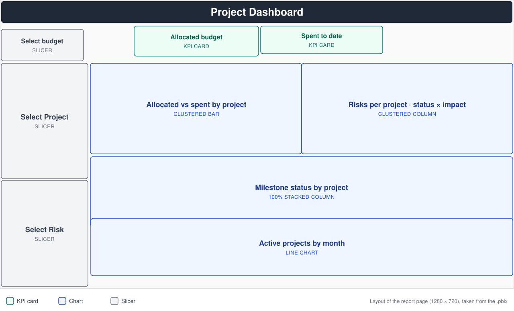
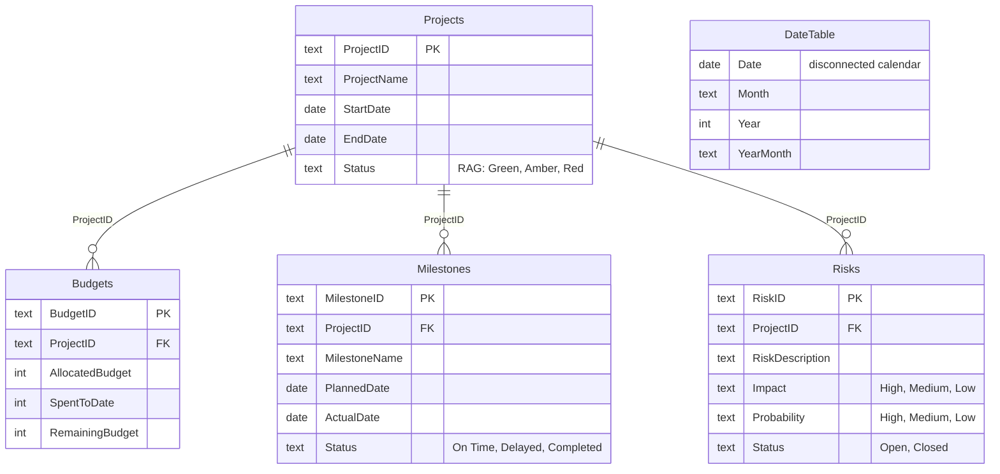

# PMO Project Portfolio Dashboard (Power BI)


A one-page Power BI dashboard for a project management office (PMO). It tracks **budget, timelines, milestones, risks and the number of active projects each month** across a portfolio of 10 projects running through 2024.


 



---

## Business questions it answers

| Question | Where on the dashboard |
|---|---|
| How much budget is allocated, and how much has been spent? | KPI cards: allocated budget, spent to date |
| Which projects are using their budget fastest? | Clustered bar: allocated vs spent by project |
| Which projects carry the most open, high-impact risk? | Clustered column: risks by project, status and impact |
| Are milestones being delivered on time? | 100% stacked column: milestone status by project |
| How many projects are running at once, month by month? | Line chart: active projects by month (DAX measure) |

Slicers for **budget**, **project** and **risk** let a PMO lead narrow everything down to one project or risk in a click.

---

## Key findings from the data

| KPI | Value |
|---|---|
| Projects | **10**: 5 Green, 3 Amber, 2 Red |
| Allocated budget | **615,000** |
| Spent to date | **403,000** (65.5% of allocation) |
| Remaining budget | **212,000** |
| Open risks | **13 of 16** (6 rated High impact) |
| Delayed milestones | **5 of 30** |
| Peak active projects | **9** (June 2024) |

- **The two Red projects are the portfolio's hotspots.** *Mobile App Launch* and *Finance Automation* have spent the most of their budgets (77% and 74%), and they hold the only two open risks rated High impact *and* High probability: security vulnerabilities and automation failure.
- **Delays happen early.** 4 of the 5 delayed milestones are first milestones, which points to slow project mobilisation rather than late-stage slippage.
- **Capacity peaks mid-year.** Active projects rise from 3 in January to 9 in June, then fall to 1 by December as projects close.

---

## Data model



- **Projects** is the central table. **Budgets**, **Milestones** and **Risks** each link to it one-to-many on `ProjectID`, with single-direction filtering, so selecting a project filters all three.
- **DateTable** is a calculated DAX calendar from the first project start to the last project end. It is deliberately **not related** to any table (see below).

More detail: [docs/data-model.md](docs/data-model.md) · [docs/data-dictionary.md](docs/data-dictionary.md)

---

## Highlight: counting active projects over time

A project has two dates, a start and an end, so a normal date relationship can only answer "which projects *started* in March?". To answer "which projects were *running* in March?", the measure compares each calendar date against both columns:

```dax
Active Projects =
VAR CurrentDate = MAX ( DateTable[Date] )
RETURN
    COUNTROWS (
        FILTER (
            ALL ( Projects ),
            Projects[StartDate] <= CurrentDate
                && Projects[EndDate] >= CurrentDate
        )
    )
```

On a monthly axis, `CurrentDate` is the last day of each month, so the line shows how many projects are in flight at each month end.

All DAX is in [`dax/`](dax/) and all Power Query (M) is in [`power-query/`](power-query/).

---

## Repository structure

```
powerbi-pmo-dashboard/
├── report/
│   └── PMO_Project_Dashboard.pbix   # the Power BI report (opens with data included)
├── data/
│   ├── pmo-data.xlsx                # source workbook: Projects, Budgets, Milestones, Risks sheets
│   └── csv/                         # the same four tables as CSV, viewable on GitHub
├── dax/
│   ├── measures.dax                 # Active Projects measure (as built)
│   ├── date-table.dax               # DateTable calculated table and columns (as built)
│   └── proposed-measures.dax        # explicit KPIs planned for the next version
├── power-query/                     # M queries for each table, with a file-path parameter
└── docs/
    ├── data-model.md                # relationships and design decisions
    ├── data-dictionary.md           # every column explained, plus data validation checks
    ├── report-guide.md              # each visual: fields, purpose, interactions
    ├── roadmap.md                   # planned improvements
    └── images/
```

---

## How to open it

1. Install **[Power BI Desktop](https://www.microsoft.com/power-platform/products/power-bi/desktop)** (free, Windows).
2. Download [`report/PMO_Project_Dashboard.pbix`](report/PMO_Project_Dashboard.pbix) and open it. The data is saved inside the file, so it opens without any setup.
3. *(Optional)* To refresh from the workbook: **Transform data → Data source settings → Change Source**, then select `data/pmo-data.xlsx` from this repository.

To rebuild the model from scratch, create the `DataFilePath` parameter and paste each query from [`power-query/`](power-query/) into the Advanced Editor.

---

## Skills demonstrated

- **Power Query (M):** importing multiple Excel sheets, promoting headers, setting data types
- **Data modelling:** a central Projects table with three one-to-many tables, and a calculated calendar table
- **DAX:** variables, `FILTER` + `ALL` context control, and a point-in-time count over a disconnected date table
- **Report design:** KPI cards, RAG status, comparison and composition charts, and slicers for interactive filtering
- **PMO reporting:** budget burn, risk exposure, milestone delivery and portfolio capacity on one page

---

## Roadmap

Explicit KPI measures (budget utilisation %, critical risks, milestone slippage), a chronological month axis, and a proper date table setup. See [docs/roadmap.md](docs/roadmap.md).

---

## Author

**Janki Mehta** · [LinkedIn](www.linkedin.com/in/janki-mehta-39783745) · [Email](mailto:jankimehta1984@gmail.com)

*Built with a Hypothetical PMO dataset of 10 projects. Budget figures are in whole currency units.*
