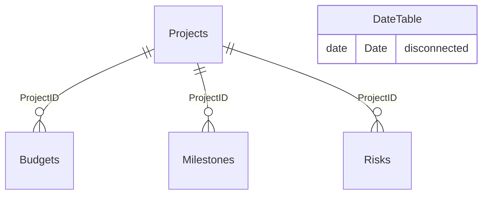

# Data model

[← Back to README](../README.md)

## Tables

| Table | Type | Rows | Source |
|---|---|---:|---|
| Projects | Dimension (central table) | 10 | `pmo-data.xlsx` › Projects sheet |
| Budgets | Fact | 10 | `pmo-data.xlsx` › Budgets sheet |
| Milestones | Fact | 30 | `pmo-data.xlsx` › Milestones sheet |
| Risks | Fact | 16 | `pmo-data.xlsx` › Risks sheet |
| DateTable | Calculated calendar (DAX) | 346 | `CALENDAR(MIN(Projects[StartDate]), MAX(Projects[EndDate]))` |

## Relationships

| From (many) | To (one) | Key | Cardinality | Cross-filter | Active |
|---|---|---|---|---|---|
| Budgets | Projects | ProjectID | Many-to-one | Single | Yes |
| Milestones | Projects | ProjectID | Many-to-one | Single | Yes |
| Risks | Projects | ProjectID | Many-to-one | Single | Yes |

With single-direction filtering, a selection on **Projects** (for example the *Select Project* slicer) flows down to Budgets, Milestones and Risks. A selection on one fact table does not flow back up to Projects or across to the other fact tables.



## Design decisions

### A disconnected calendar for "active" projects

Each project has a `StartDate` and an `EndDate`. A relationship from a calendar to one of those columns could only show projects that *started* (or ended) in a period. The question here is how many projects were *running* in each month, so `DateTable` has **no relationship**. The `Active Projects` measure reads the latest date in context and checks it against both columns:

```dax
Active Projects =
VAR CurrentDate = MAX ( DateTable[Date] )
RETURN
    COUNTROWS (
        FILTER (
            ALL ( Projects ),
            Projects[StartDate] <= CurrentDate
                && Projects[EndDate] >= CurrentDate
        )
    )
```

`ALL ( Projects )` makes the line show the whole portfolio whatever is selected in the project slicer. A slicer-aware version is in [`dax/proposed-measures.dax`](../dax/proposed-measures.dax).

### Calendar range follows the data

`DateTable` runs from the earliest project start (5 Jan 2024) to the latest project end (15 Dec 2024), so the trend never shows empty months outside the portfolio's life.

### Auto date/time

Power BI's *Auto date/time* option is on, so the model also holds hidden `LocalDateTable_*` tables for each date column. Turning it off and marking `DateTable` as the date table is on the [roadmap](roadmap.md).

## Monthly result of `Active Projects`

| Month (2024) | Jan | Feb | Mar | Apr | May | Jun | Jul | Aug | Sep | Oct | Nov | Dec |
|---|---|---|---|---|---|---|---|---|---|---|---|---|
| Active at month end | 3 | 6 | 8 | 8 | 8 | **9** | 7 | 6 | 5 | 3 | 2 | 1 |

*December is measured at 15 Dec, the last date in the calendar.*
